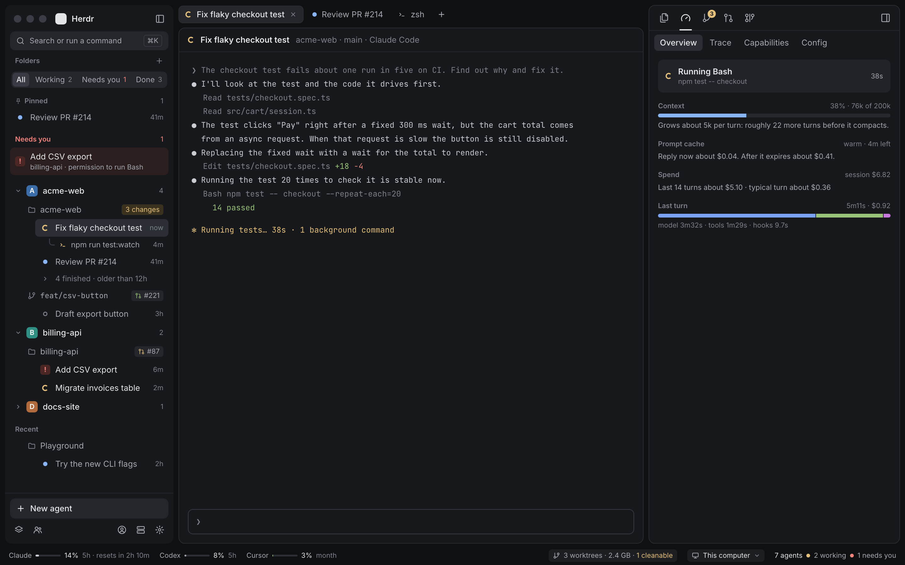
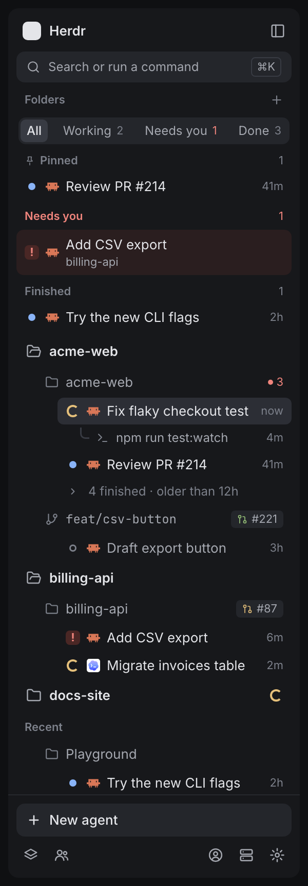
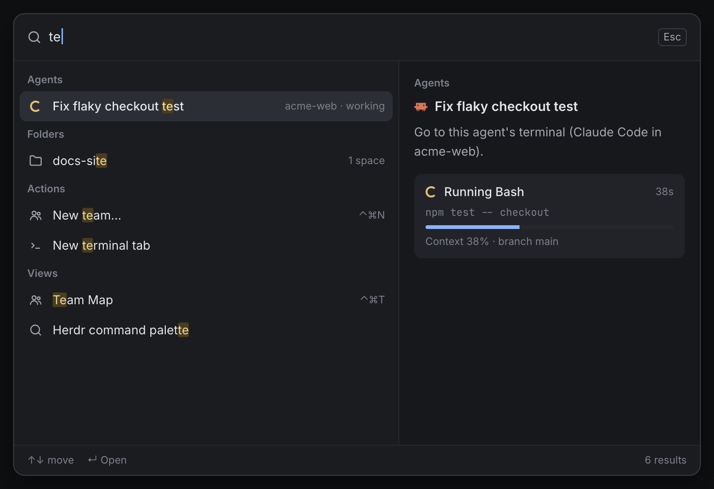
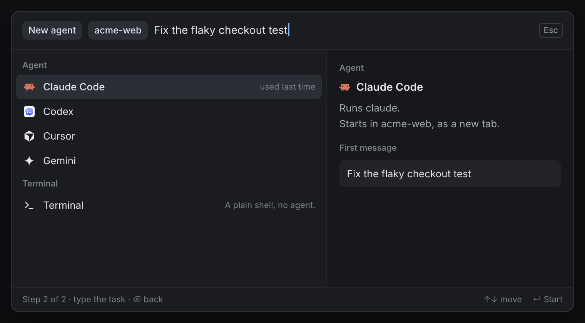
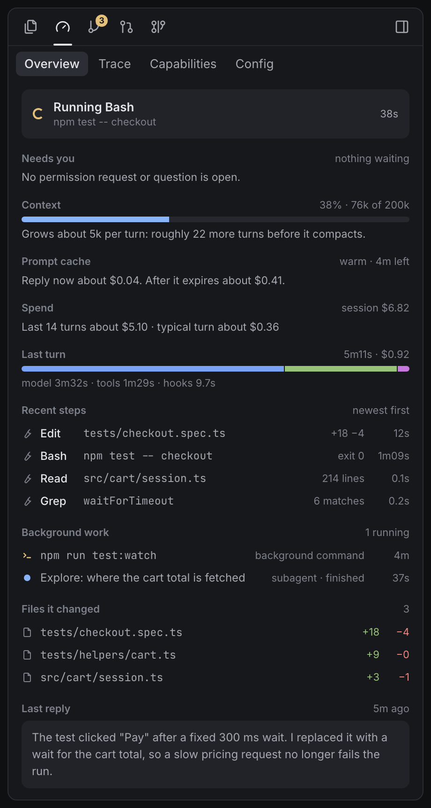
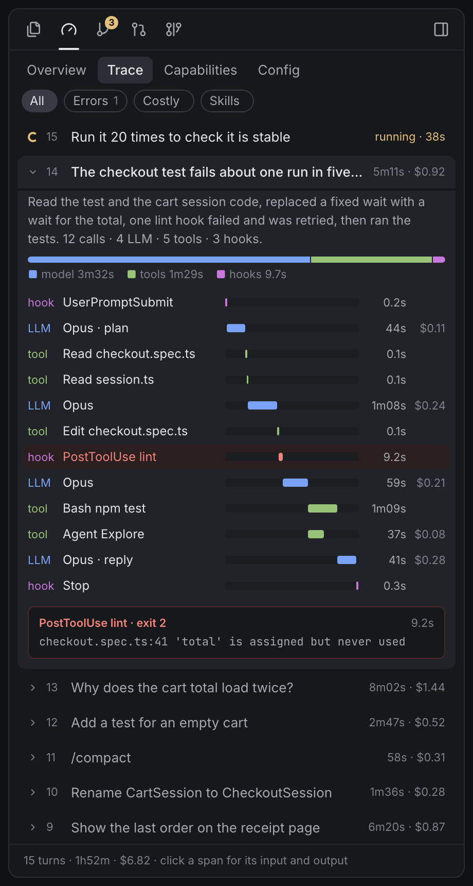
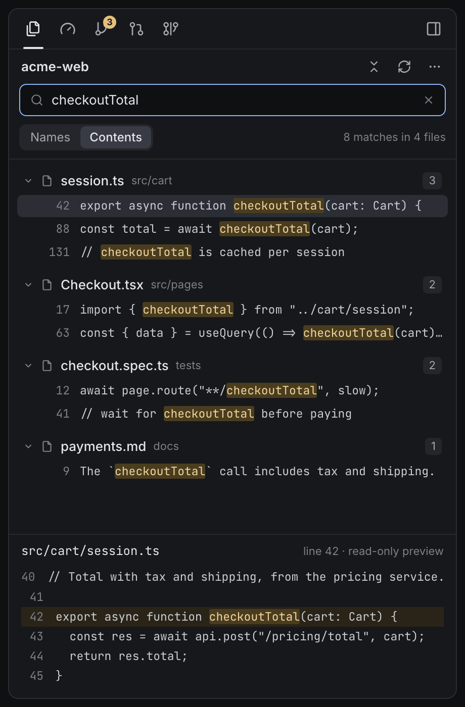
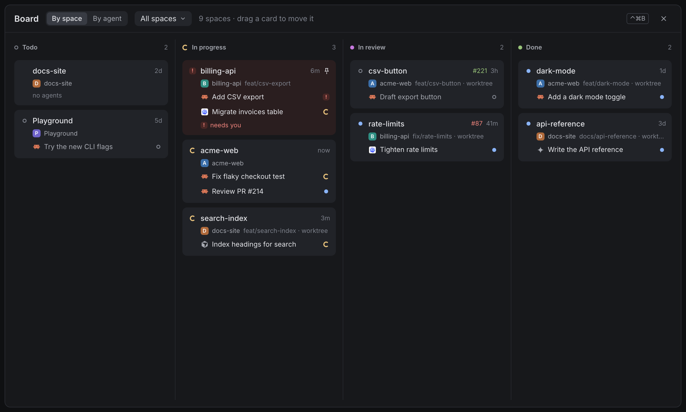
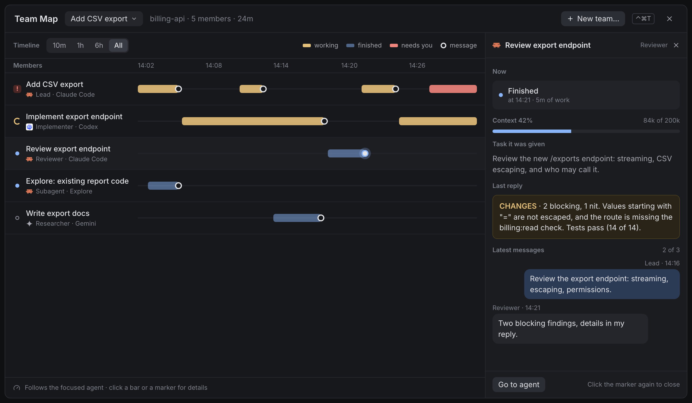
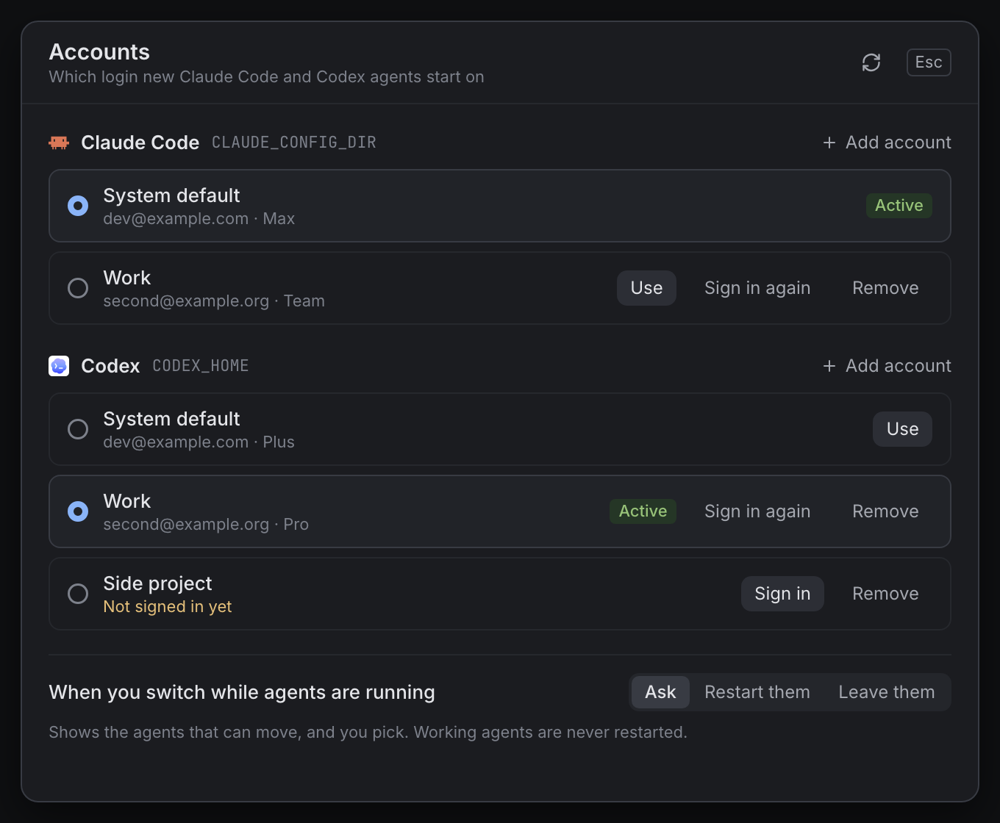

# herdr-ranch

A set of mods, one layout and helper scripts for the [Herdr](https://herdr.dev) desktop app that turn it into a
workspace for running many coding agents (Claude Code, Codex, and others) across several projects. It adds a
sidebar organised by folder and status, a command bar, an agent inspector, a pull-request panel, a board, agent
teams, account switching and usage meters.

It is for people who already use Herdr with `hc` (herdr-core) and want one window in which they can see which
agent needs them, what each one is doing and what it costs.

> Status: a personal setup that is being opened up. It is tested on macOS only, and several mods are edited
> copies of mods that ship with Herdr (see [Credits and licenses](#credits-and-licenses)).

<p align="center"><br><em>The whole window: sidebar, terminals, right panel, status bar.</em></p>

Screenshots are illustrative mockups with sample data. To regenerate them: `docs/img/src/render.sh` (runs `gen.py`, then headless Chrome).

## Feature tour

### Sidebar

<p align="center"><br><em>The sidebar: status filter, Pinned, Needs you and Finished, then folders with their spaces and agents.</em></p>

- **Folders, spaces, agents.** Spaces are grouped into folders (drag a space onto a folder, or give the folder
  path rules so it collects matching spaces). A folder can be made of several folders on disk (the repos of
  one project): a space belongs to the folder it was started in and stays there when its agent `cd`s elsewhere. Worktree spaces sit under their checkout. Each space lists its
  agents with a status mark, context bar and the time since its state changed. Spaces in no folder are listed
  under **Recent**. (`space-folders`)
- **Status filter.** All / Working / Needs you / Done in the header shows the same tree with only the agents
  in that state, and the spaces and folders that hold them. Click the active one again to go back to All.
- **Pinned / Needs you / Finished.** With no filter on, pinned agents, agents waiting for you and agents that
  finished while you were elsewhere are repeated in sections at the top, each with the name of its space.
- **12-hour fold.** Agents that finished or went idle more than 12 hours ago fold into one line per space.
- **Background-work indicator.** Under a Claude Code agent: the `hc` sub-agents it started and its running
  background subagents and background shell commands. (`lib/agentrows.js`, `lib/subs.py`)
- **Top and bottom.** A brand row and a "Search or run a command" row at the top; at the bottom "New agent",
  then buttons for Board, Team Map, Accounts, Add machine and Settings. (`sidebar-foot`)
- Per-space PR badge and uncommitted-change count; hover a repo row for New worktree / Clean up / New team.

### Command bar (⌘K)

<p align="center"><br><em>The command bar: agents, folders, actions and views in one list, with a preview of the highlighted row.</em></p>

<p align="center"><br><em>New agent: pick the folder, then the agent; what you typed becomes its first message.</em></p>

One box that filters agents (agents that need you first), folders, spaces, actions and views; the right side
explains the highlighted row. (`command-bar`)

- **Go to** an agent or a space.
- **Actions:** New agent, Resume a conversation, Restore agents, New team, New worktree, Add machine, Accounts, New space, New terminal tab, Split
  right, Toggle sidebar, Toggle details panel, and "Compact this agent's context" for a focused Claude agent.
- **Views:** Board, Team Map, the four Inspector tabs, Changes, Git graph, Pull requests, Files, Resource
  Manager, Accounts, Settings, Keybinds, Herdr's own command palette.
- **New agent flow:** pick a folder (or "This space"; a folder made of several folders asks which one), pick one
  of the agents Herdr reports as installed (or a plain terminal); whatever you typed becomes its first message. Backspace on an empty box goes back a step.
- **Resume a conversation:** lists the past Claude Code and Codex conversations started in this space's folder or
  in folders under it, such as `.claude/worktrees/<name>` (newest first, with the first and last thing you typed;
  one still open elsewhere, like the Claude app, is marked), and continues the picked one in a new tab in its own
  folder (`claude --resume` / `codex resume`, on the active account). Also at the end of
  the New agent flow, and in the sidebar's space and folder menus. (`lib/sessions.py`)

### Right panel

Five icon tabs (`stack-tabs`) in Herdr's own panel:

<p align="center">  <br><em>Inspector Overview, Inspector Trace, and Files searching inside files.</em></p>

- **Files** (`files-plus`): a lazy file browser for the focused pane's folder with read-only previews, and
  search by file name or inside files (the latter needs `rg`; one row per hit, at most 3 per file). Clicking a
  result opens the whole file, read-only, with syntax colors.
- **Inspector** (`agent-inspector`), for the focused Claude Code or Codex agent:
  - *Overview*: what it is doing now, what needs your attention, how long the context will last and what fills
    it, what replying before or after the prompt cache expires costs, session spend with unusually costly turns,
    and its subagents.
  - *Trace*: one row per turn with a stats line (time, calls, tools, tokens, cache hit, cost); filters for turns
    with errors, costly turns and turns that loaded skills. An open turn shows its time split (model, tools,
    waiting for you, other) and a waterfall of LLM calls, tools, subagents and hooks, with per-call detail.
  - *Capabilities*: skills, MCP servers and tools: what it could use, what it used, what each costs in context.
  - *Config*: model and mode, memory files, hooks by name with their health.
- **Changes** (`changes-plus`): uncommitted changes with coloured diff rows.
- **Pull requests** (`pr-panel`, `pr-diff`): tabs Mine / To review / Space / Issues, PRs grouped by whose move
  it is. Buttons start an agent in a worktree (Fix CI, Fix comments, AI review, Ask Claude), show the diff, or
  open GitHub; optional "request review" buttons run a command you configure.
- **Git graph** (`git-graph`): commit graph with a branch picker, checkout with a stash prompt, compare two
  branches, PR badges with CI state, and fetch / pull / push and other git actions behind a confirmation.

### Full pages

<p align="center"><br><em>Board, by space.</em></p>

<p align="center"><br><em>Team Map, with the details of one teammate open.</em></p>

- **Board** (⌃⌘B, `space-board`). *By space*: every space as a card in Todo / In progress / In review / Done;
  placed automatically from agent state and open PRs until you drag it (↺ on the card puts it back); the PR
  number is colored by CI; cards can be pinned. *By agent*: one
  card per agent in Needs you / Working / Finished / Idle.
- **Team Map** (⌃⌘T, `agent-team`): a timeline of the focused agent's team: one lane per teammate (agents it
  started with `hc run`, Claude subagents, sessions it messaged) with bars for working, finished and waiting for
  you, and each message as a marker. Click a teammate for its details.

### Agent teams

- **Templates** (`templates/`): role prompts for `hc run`: implementer, reviewer and researcher for Claude,
  Codex, Grok, Cursor and Gemini (not every combination). Installed into `~/.config/herdr-core/templates`.
- **Playbooks** (`teams/`): instructions for a lead agent in four patterns: Maker / Checker, Leader / Workers,
  Arena, Research → Build.
- **Launcher** (⌃⌘N, `team-launch`): type the task and press Enter. It starts a lead Claude Code in auto mode
  with the playbook; only its `hc` calls are pre-approved. The lead makes `team/…` worktrees and starts the
  members. "More options…" shows pattern, repo and who plays each role (defaults from `agent-team.json`).

### Accounts

<p align="center"><br><em>The Accounts dialog.</em></p>

More than one Claude Code or Codex login (`accounts`, `lib/accounts.py`). The Accounts dialog adds an account
(you name it; the name can be changed later), picks the one new agents start on, signs in again or removes one. An added account is a folder used as
`CLAUDE_CONFIG_DIR` / `CODEX_HOME` whose contents, apart from the login, are symlinks to `~/.claude` /
`~/.codex`, so settings and conversations are shared. Claude Code keeps trusted folders and MCP servers in
`.claude.json` next to the login, which cannot be a symlink: before an agent starts on an added account, those
are copied in from `~/.claude.json` (the login's own keys are never copied, nothing the account recorded is
removed), so a folder trusted once is trusted under every account.

After a switch, agents that are idle, finished or stopped on an error (out of usage, usually) can be restarted
on the new account: the conversation is resumed in a new tab (`claude --resume` / `codex resume`) and the old
tab closes. An agent that is working or waiting for you is not interrupted; it moves by itself once it is free.

Agents started from Herdr always use the picked account. For a `claude` or `codex` you type yourself in a Herdr
terminal to do the same, install with `--shell` (one line in your shell rc; no effect outside Herdr).

### Restore after a restart

Herdr keeps every terminal across a reboot, a logout or a core crash, but brings it back as a shell: the agent
that ran in it is not started again. With the session hook installed (`./install.sh --restore`), each Claude
Code and Codex conversation writes its id and start folder as labels on its own terminal, and labels survive
the restart. When Herdr is back, the status bar shows **Restore N agents** (`agent-restore`): its dialog lists
them, and Resume types `cd <folder> && claude --resume <id>` (or `codex resume <id>`) into the same terminals,
one after another, on the account in use. Ask (the default), Automatically, or Off. A conversation you left
yourself (`/exit`) is not offered. What an agent was doing when Herdr stopped is cut short, and programs it
left running in the background are not started again.

### Status bar

- **Usage meters** (`usage-bar`): plan usage and reset times for Claude, Codex and Cursor for the active
  account. A Grok slot exists but has no data source.
- **Worktrees pill** (`worktrees`): worktree count, disk used and how many can be cleaned. It opens the
  **Resource Manager**: CPU and memory per repo, worktree and terminal, disk use, and a guarded clean-up list.

### Notifications

`agent-toast` replaces the toast for agent events: which agent, Finished or Needs you, space, branch and tab.
When Herdr is not the front app it posts a macOS notification through `Herdr Notify.app` (click focuses the
agent), falling back to `osascript`. Sounds are set in `agent-toast.json`.

### Worktrees

Dialogs for New worktree (from a base branch, an existing branch or a PR), Delete (showing what would be lost)
and Clean up. New worktrees go to `~/.herdr/worktrees/<repo>/<branch>`; files listed in `.worktreeinclude` are
copied and `orca.yaml` `worktree.sharedDirectories` are linked.

A one-line index of every mod is in [docs/MODS.md](docs/MODS.md).

## Requirements

- macOS (the only platform this is tested on; keychain access, notifications and sounds are macOS-specific).
- The Herdr app, started at least once so `~/.config/herdr-app` exists, with `herdr-app` and herdr-core's
  `hc` on your `PATH`.
- `git`, `python3`, `rsync` (the installer refuses to run without them).
- Optional: `gh` signed in (PR panel, PR badges, worktree from a PR), `rg` (search inside files), `swiftc`
  from the Xcode command line tools (Herdr Notify.app), Node.js (tests), and the agent CLIs you use: `claude`,
  `codex`, `grok`, `cursor-agent`, `gemini`.

## Install, update, uninstall

```sh
git clone <this repository> herdr-ranch
cd herdr-ranch
./install.sh --dry-run      # show what would change
./install.sh                # install, or update after a pull
./install.sh --statusline   # also add the snapshot hook to your Claude Code status-line script
./install.sh --shell        # also make a plain claude / codex typed in a Herdr terminal use the picked account
./install.sh --restore      # also add the session hook that lets agents be brought back after a restart
```

Then switch Herdr to the **focus** layout. Edit files in this repo and re-run the installer; do not edit the
installed copies.

What `install.sh` writes (`$APP` is `~/.config/herdr-app`, or `$HERDR_APP_HOME`):

| Where | What |
|---|---|
| `$APP/mods/<name>/` | every folder in `mods/`, plus the `lib/` files its `lib.json` lists (replaced on each run) |
| `$APP/layouts/focus.json` | the layout |
| `$APP/ranch/icons/`, `$APP/ranch/requesters/`, `$APP/ranch/teams/` | Lucide icons, the Slack requester, team playbooks |
| `~/.config/herdr-core/templates/*.md` | the role templates |
| `~/.claude/herdr-status-snapshot.py` | status-line snapshot helper (only used once your status line calls it) |
| `~/Applications/Herdr Notify.app` | built with `swiftc`, ad-hoc signed, using the icon of the installed Herdr.app; skipped without `swiftc` |
| `$APP/keys.json` | keys from `config.example/keys.json` are merged in; a key you already bound is kept and reported |
| your status-line script | only with `--statusline`: one line added after `input=$(cat)`, backup saved as `<script>.bak-ranch` |
| `~/.zshrc` (or `~/.bashrc`) | only with `--shell`: one line that sources `$APP/ranch/shell-accounts.sh` |
| `~/.claude/settings.json`, `~/.codex/hooks.json` | only with `--restore`: a SessionStart (Claude Code: and SessionEnd) hook running `$APP/ranch/agent-session-hook.py`; backups saved as `<file>.bak-ranch`; `integrations/agent-restore/wire.py --remove` takes it out |
| `~/.cache/herdr-ranch/` | checkouts of mods pinned in `vendor.json` (none at present) |

It never writes your personal config. Copy what you need from `config.example/` into `$APP`:
`pr-panel.json` (review-request buttons), `slack-review.json` (channel and bot for the Slack requester),
`agent-toast.json` (sounds), `agent-team.json` (which agent plays which role).

Files the mods create while running: `$APP/ranch/accounts.json`, `$APP/ranch/accounts/` and
`$APP/ranch/active-claude` / `active-codex` (accounts; an added account's `.claude.json` is kept up to date as above),
`~/.config/herdr-space-folders.json` (folders), `~/.cache/herdr-claude-status/` (usage and status-line caches),
`~/.herdr/worktrees/` (worktrees).

There is no uninstall script. To remove everything: switch to another layout, delete the paths in the table
above (for `mods/`, the folders named like those in this repo's `mods/`), remove the merged keys from
`keys.json`, and restore `<script>.bak-ranch` if you used `--statusline` (and delete the `herdr-ranch accounts` line from your shell rc if you used `--shell`). Mods removed from this repo are not
removed from `$APP/mods` by an update; delete them by hand.

### Key bindings added

| Key | Does |
|---|---|
| ⌘K | command bar |
| ⌃⌘B | Board page |
| ⌃⌘T | Team Map page |
| ⌃⌘N | New team |
| ⌃⌘G | show or hide the right panel |
| ⌥↓ / ⌥↑, ⌃⇧PageDown / ⌃⇧PageUp | next / previous space (focus layout only) |

## Developing a mod

Herdr's mod API is described in `~/.config/herdr-app/AGENTS.md`.

```sh
scripts/dev.sh <mod>     # build one mod with its lib files, install it, run `herdr-app check` on it
npm test                 # git-graph unit tests (tests/git-graph)
```

- One concern per mod. Mods cannot import each other; they talk through overlay props and `shared` keys.
- Code used by two mods goes in `lib/`. A mod lists the lib files it needs in `lib.json`, and the installer
  copies them into the installed mod. A mod's Python that imports a `lib/` module must list it too.
- `herdr-app check <mod folder>` must pass (both scripts run it).
- No personal ids or paths in code; they belong in `~/.config/herdr-app/*.json`, with an example in
  `config.example/`.

## Privacy and safety

The mods read local files and run local programs. They do not collect or upload your transcripts. They do make
network requests, all listed here.

What is read on your machine:

- Agent transcripts and session files: `~/.claude/projects`, `~/.claude/sessions`, `~/.codex/sessions`, and
  the same under added account folders (inspector, sidebar, toasts, Team Map). Text shown from them is
  redacted for secret-looking strings.
- `~/.claude` and `~/.codex` config (settings, hooks, MCP, skills) for the Inspector's Config and Capabilities.
- Logins, for the usage meters only: the keychain items `Claude Code-credentials` (and
  `Claude Code-credentials-<hash>` for added accounts) and `cursor-access-token`, and the Codex token in
  `auth.json`. The Accounts dialog reads only the e-mail and plan, and stores no credential.
- The keychain item `herdr-slack-review` / `user-token`, only if you set up the Slack requester.
- Git repositories behind your spaces, through `git`; process and disk figures through `ps`, `du`, `lsof`.

Every network call in the code:

| Where | Request | Sends |
|---|---|---|
| `mods/usage-bar/usage.py:44` | GET `api.anthropic.com/api/oauth/usage` | Claude Code's OAuth token |
| `mods/usage-bar/usage.py:176` | GET `chatgpt.com/backend-api/wham/usage` | the Codex access token and account id |
| `mods/usage-bar/usage.py:210` | GET `cursor.com/api/usage-summary` | cursor-agent's token as a session cookie |
| `mods/git-graph/update.js:43` | GET `api.github.com/repos/rabeeh-ta/herdr-git-graph/releases/latest`, at most daily. **Off by default**: it runs only after you tick "Check for updates" in the Git graph's settings (the gear) | nothing about you |
| `integrations/requesters/slack-post.py:40-48` | `slack.com/api/…`, only when you click a configured requester | your Slack user token and the message |
| `lib/prs.js:35`, `mods/pr-panel/github.js:23,35`, `mods/pr-diff/main.js:23`, `mods/worktrees/wtviews.js:61` | `gh api graphql`, `gh pr diff`, `gh pr view` | whatever your `gh` sign-in sends to GitHub |
| `mods/git-graph/repos.js:73`, `mods/git-graph/git.js:341-356`, `mods/pr-panel/launch.js:34,114`, `mods/worktrees/wt.js:106` | `git fetch` / `pull` / `push` to your own remotes | your git credentials, to your remotes |

The three usage endpoints are the ones each vendor's own client uses; they are not documented public APIs and
may change or be disallowed by a vendor's terms. Tokens are sent only to their own vendor and are not written
to disk; cached results (percentages and reset times) are stored in `~/.cache/herdr-claude-status/`.

Things that act on your behalf: PR buttons and the team launcher start agents (the team lead in Claude Code's
auto mode); the Accounts switch can close and restart agents that are not busy, and copies your trusted folders and MCP
servers into added accounts; worktree clean-up deletes folders after a
confirmation; git-graph can push, delete branches and reset after a confirmation. PR and issue text is never
pasted into a prompt: the agent is given the repo, number and URL and told to treat what it reads as data.

## Limitations and known gaps

- Tested on macOS only. Keychain reads, notifications and sounds have no other implementation.
- Codex does not log hook runs, tool counts or schema sizes, so the Inspector shows configured hooks without
  counts or errors and a plainer trace for Codex.
- Context % and cost for Claude agents need the status-line snapshot hook (`--statusline`).
- Switching account restarts agents (when they are not busy) rather than moving a live session. After a
  resume under another account, thinking from the earlier turns is not reused and the first reply is slower.
- Usage: no Grok data; Claude, Codex and Cursor depend on undocumented endpoints.
- Several mods are frozen copies of Herdr's shipped mods and do not pick up Herdr's updates.
- `git-graph` still checks the upstream project's releases, although the copy here has diverged.
- No uninstall script; no full-text search over conversations.
- Tests cover only `git-graph`.

## Credits and licenses

> **License:** Apache-2.0 (see `LICENSE` and `NOTICE`). Mods derived from Herdr's built-in mods and other third-party parts are listed in `NOTICE` and `licenses/README.md`.

This repository has no license of its own yet. Code that started elsewhere:

| Here | Origin | License |
|---|---|---|
| `mods/git-graph`, `tests/git-graph` | [rabeeh-ta/herdr-git-graph](https://github.com/rabeeh-ta/herdr-git-graph) v0.3.3, since modified | MIT (`licenses/git-graph-MIT.txt`) |
| `mods/space-folders` | [jankeesvw/herdr-space-folders](https://github.com/jankeesvw/herdr-space-folders) @63a78b2, since modified; itself a clone of Herdr's `spaces` mod 0.1.10 | MIT or Apache-2.0 for the upstream author's part (`licenses/space-folders-*.txt`); the Herdr part: see below |
| `lib/folders.js` | folder matching ported from herdr-space-folders | MIT |
| `lib/icons/*.svg`, `lib/team.svg`, `lib/more.svg`, `lib/folder-open.svg`, most of `mods/git-graph/icons` | [Lucide](https://lucide.dev) | ISC (`licenses/lucide-ISC.txt`) |
| `mods/changes-plus` | clone of Herdr's `changes` mod 0.1.14, modified | not established |
| `mods/tabs-plus` | clone of Herdr's `tabs` mod, modified | not established |
| `mods/files-plus` | clone of Herdr's `files` mod, modified | not established |

**Unclear:** the four clones of Herdr's shipped mods, and the Herdr-derived part of `space-folders`, are
Herdr's code. No license for them is included in this repository, and their redistribution terms have not been
checked. `Herdr Notify.app` also uses the Herdr name and, at build time, the installed app's icon.

Ideas, not code: the usage line, resource manager, accounts and worktree conventions follow
Orca; the command bar follows Arc and Raycast; git-graph's multi-repository
view follows [manygit](https://github.com/rabeeh-ta/manygit).

Herdr is a product of its own authors; this project is not affiliated with it.
